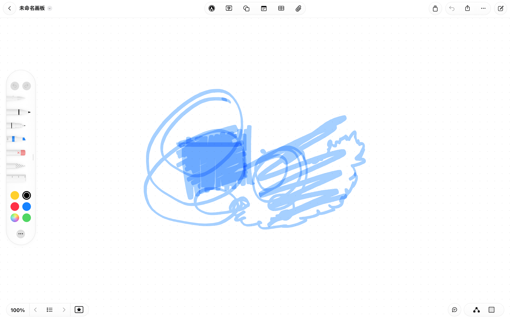
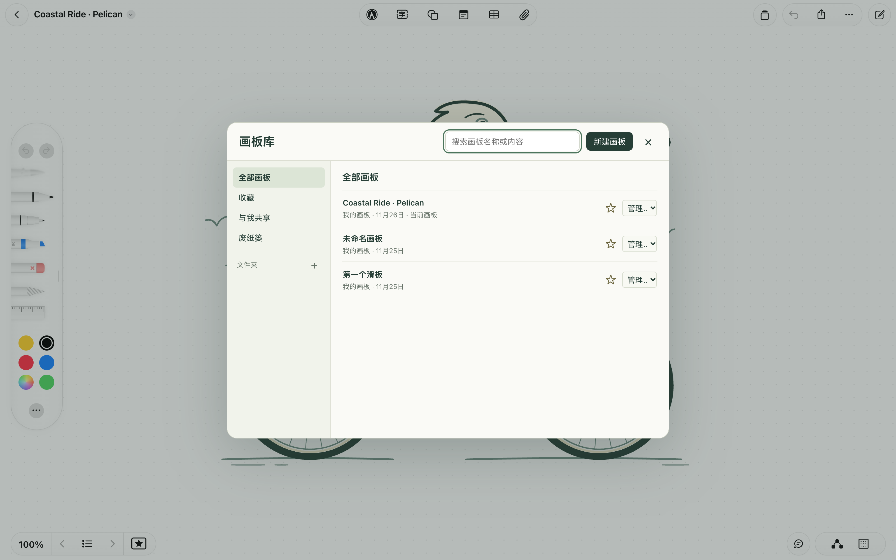

# Folio

**A self-hosted infinite canvas for the web, built for stylus work and multiple devices.**

[English](README.md) · [简体中文](README.zh-CN.md) · [MIT License](LICENSE)

Folio is a browser whiteboard you can run on your own server. It builds on the editor, store, shape and history model of Quickdraw 0.3.0 and extends it with stylus ink, attachments, tables, scenes and device collaboration. The server is a single Bun + Hono process backed by SQLite. Open the page and start drawing.

## Highlights

- **Infinite canvas** — pan, zoom, select, arrange, align, snap, undo and redo.
- **Stylus-native ink** — pressure, tilt, twist and tangential pressure are stored per sample; pen, pencil and highlighter brushes.
- **Shapes, text, notes, tables and connectors** — plus images, PDFs and arbitrary file attachments.
- **Scenes** — divide a board into framed views and export single or multi-page PDFs.
- **Live collaboration** — incremental operations over HTTP, streamed to other tabs and devices over SSE, with presence, roles and share links.
- **Multi-device** — pair devices with a one-time link, or run one shared workspace for every device.
- **Offline-first PWA** — installable shell, service worker and per-device cache scope.
- **Portable boards** — export a self-contained `.folio.json` copy and import it on another instance.
- **Built-in AI chat (optional)** — an in-process Peri agent drives the board through MCP. Bring your own OpenAI-compatible or Anthropic endpoint.
- **Self-hosted** — one service, one SQLite file, no external dependencies.

## Board library



## Get started

Requires [Bun 1.4.5](https://bun.sh/).

```sh
git clone https://github.com/KonghaYao/folio.git
cd folio
bun install --frozen-lockfile
bun run build
bun start
```

Open http://localhost:3000. The default database lives at `data/folio.sqlite`.

A packaged delivery keeps the built client and server: run `bun service/index.js` from the extracted `folio/` directory instead of building.

### Development

```sh
bun run build    # once, so the API server can serve the app shell
bun start        # API and built assets on :3000
bun run dev      # Vite on :5173, proxying /api to :3000
```

Run the server in one terminal and Vite in another.

### Docker Compose

```sh
docker compose up -d --build
```

The service binds `127.0.0.1:3000` by default and persists boards, assets and permissions to the `folio-data` volume. Set `FOLIO_BIND` and `FOLIO_PORT` to change the host binding.

## Configuration

| Variable | Default | Purpose |
| --- | --- | --- |
| `PORT` | `3000` | HTTP port |
| `HOST` | `0.0.0.0` | Bind address |
| `FOLIO_DB` | `./data/folio.sqlite` | SQLite database path |
| `PUBLIC_ORIGIN` | request origin | Public origin allowed to write, including scheme and port. Set it when the browser origin differs from the server's internal origin behind a proxy; also marks cookies `Secure` |
| `FOLIO_SHARED_WORKSPACE` | unset | Set any name to put every device in one workspace. Existing boards are adopted on startup |
| `FOLIO_AI_ALLOWED_ORIGINS` | unset | Comma-separated origins allowed as AI provider endpoints over HTTP or private addresses |
| `FOLIO_BIND` / `FOLIO_PORT` | `127.0.0.1` / `3000` | Docker Compose host binding |

Behind a reverse proxy, forward `/api/` including SSE, disable response buffering for streams and allow long read timeouts. Full offline and clipboard features need HTTPS or `localhost`.

## How it works

The client is a Vite + TypeScript application. Quickdraw owns picking, gestures, editing, transforms and history; Folio adds stylus sampling, brushes, attachments, tables, scenes, the library, sharing and the offline shell. The Bun + Hono server stores boards, objects, asset bytes, device mappings and permissions in SQLite with WAL, foreign keys and full synchronous commits. Changes travel as incremental operations and are replayed to other clients over SSE.

- `client/` — canvas editor extensions, UI shell, library, chat and offline support
- `server/` — HTTP API, SQLite store, events, devices, sharing and the Peri agent runtime
- `shared/` — protocol types shared by both sides
- `docs/` — capabilities, architecture, storage, chat, interface and performance notes
- `qa/` — browser acceptance, synchronization and performance suites

## Documentation

| Document | Contents |
| --- | --- |
| [docs/capabilities.md](docs/capabilities.md) | Feature matrix against Apple Freeform, with acceptance evidence |
| [docs/architecture.md](docs/architecture.md) | Code layout and data flow |
| [docs/storage.md](docs/storage.md) | Data model, backups and deployment |
| [docs/chat.md](docs/chat.md) | AI provider setup and agent architecture |
| [docs/interface.md](docs/interface.md) | Interface and interaction details |
| [docs/performance.md](docs/performance.md) | Large-board performance measurements |
| [qa/README.md](qa/README.md) | Browser acceptance suite |

## Checks

```sh
bun run check   # formatting, typecheck, tests, production build
```

The browser acceptance suite uses Python and Playwright; see [qa/README.md](qa/README.md).

## License

[MIT](LICENSE)
