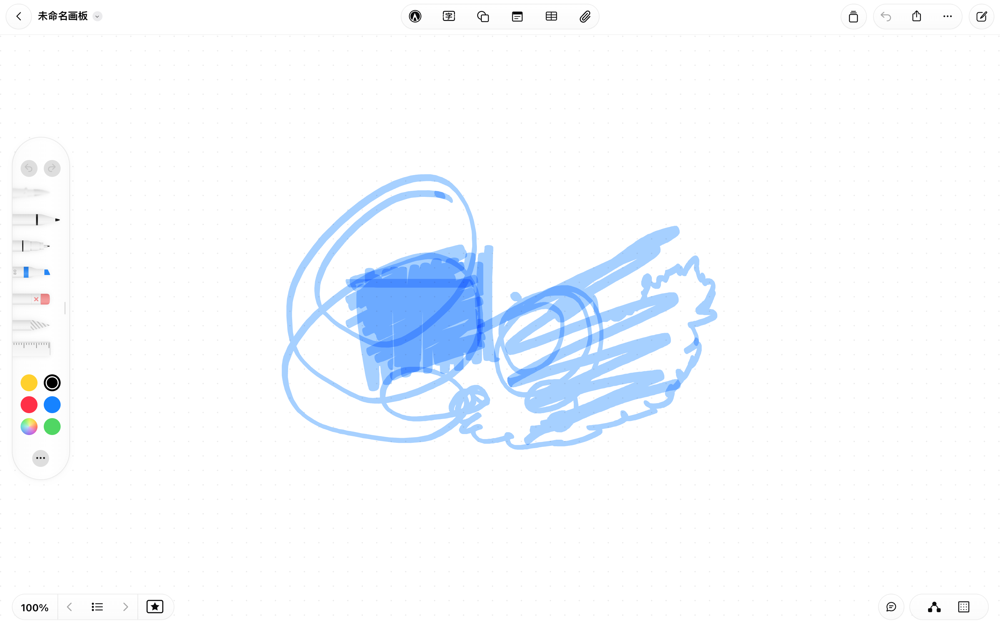

# Folio 无边画板

[English](README.md) · 简体中文

Folio 是可以自行部署、跨设备使用的浏览器无限画板。画布以 Quickdraw 0.3.0 的 Editor、Store、形状和历史模型为基础，浏览器端扩展笔尖、附件、表格、场景和设备协作。服务端使用 Bun、Hono 与 SQLite。打开网页即可开始作画。

## 启动

交付包内含已构建的客户端和服务端。安装 Bun 1.4.5 后，在解压后的 `folio` 目录执行 `bun service/index.js`，即可使用包内构建启动服务。

从源码重建时，在解压后的 `folio` 目录运行以下命令。

```sh
bun install --frozen-lockfile
bun run build
bun start
```

打开 [本地画板](http://localhost:3000)。默认数据库位于 `data/folio.sqlite`。更新前端后再次构建。开发时可另开一个终端运行 `bun run dev`，其 Vite 代理默认连接本机 3000 端口。

也可以使用 Docker Compose。命名卷 `folio-data` 保存画板、附件、设备工作区及权限。容器重建后继续使用该卷。运行镜像只复制前端产物和 Bun 服务包。容器内的备份工具入口为 `bun service/backup.js`。

```sh
docker compose up --build -d
```

多设备部署需要各设备能访问同一服务地址。Compose 默认绑定回环地址，适合前置 HTTPS 反向代理。代理需要转发 `/api/`，对 SSE 关闭响应缓冲，并使用足够长的读取超时。将 `PUBLIC_ORIGIN` 设为用户实际打开的 HTTPS 源（含非默认端口，不带路径和尾随斜线）。若只想在局域网试用，可设 `FOLIO_BIND=0.0.0.0`，各设备打开服务器的局域网地址。浏览器的完整离线和剪贴板功能需要 HTTPS 或 localhost。设置 `FOLIO_SHARED_WORKSPACE=<名称>` 后，所有设备共用该名称对应的工作区，启动时会把已有画板并入其中；不设置时每台设备保留独立的匿名工作区。

## 用 Chat 操作画板

打开右下角 **画板 Chat**，在面板设置中填入 Provider、模型 ID、Base URL 与 API Key，就能请 Agent 操作左侧画布。支持 OpenAI Chat Completions 兼容服务和 Anthropic Messages。Agent 的编辑支持撤销并同步到其他设备。API Key 只在本标签页内存和当前服务请求中使用，刷新后需要重新输入。[模型配置、MCP 工具与聊天记录](docs/chat.md)

## 对照参考界面

打开左上角画板名称菜单，选择 **打开示例画板**。也可以在服务地址后添加 `/?sample=agent-design` 打开示例。它会生成一张名为 **Agent Design** 的可编辑画板，以 25% 的初始视图排布手写标签、色块与连接线。普通新建画板仍从空白开始。重新进入同一画板时会优先使用本设备上次的缩放与视野中心。

顶部居中的工具组用于绘图、文字、形状、便签、表格和附件。左侧笔盒提供画笔、荧光笔、橡皮、套索、直尺与颜色。底部左侧管理缩放和场景，右侧管理连线与网格。

## 配对、分享与恢复

1. 电脑打开画板，点击左上角画板名称，选择 **同步我的设备 → 生成一次性配对链接**。在手机或平板打开链接，点击 **连接此设备**。链接五分钟有效，只能兑换一次。配对后，画板、文件夹和收藏使用同一工作区。
2. 和他人协作时，点击右上角 **共享**，选择只读或可编辑权限。授权范围为当前画板，可以撤销。第二台设备配对前的工作区可以从设备菜单切换回来。设备丢失时，可在另一台可信设备的同一菜单中断开它。
3. 在已访问的画板上离线绘图，恢复连接后编辑会补传。两端修改同一形状的不同属性可合并，同时修改同一属性会保留对方版本，并尽可能生成本地冲突副本。画板顶部显示保存状态。
4. 在 **更多操作 → 导入画板** 选择 `evidence/pelican.folio.json`，即可打开浏览器验收时的可编辑鹈鹕作品。整张画板、场景 PDF 和可携带副本均通过画板的导出菜单获取。

## 工程结构

| 目录 | 职责 |
| --- | --- |
| `client/canvas/` | Quickdraw 适配层、输入采样、形状绘制、命中、组合、连接线和附件 |
| `client/api.ts`、`client/net.ts`、`client/merge.ts` | HTTP 协议、单画板串行提交、增量读取及字段级冲突处理 |
| `client/offline.ts`、`client/asset-cache.ts`、`build/` | 工作区隔离的本地快照、待提交编辑、素材缓存和离线应用壳 |
| `client/extras/`、`client/objects.ts`、`client/image-crop.ts` | 场景、查找、可携带副本、表格、图表与图片裁剪 |
| `server/` | Hono 路由、会话和授权、输入校验、SQLite 事务、SSE、附件与备份 |
| `tests/`、`qa/`、`evidence/` | 存储与业务回归、真实浏览器验收脚本、操作结果及可编辑作品 |

`bun run check` 执行格式一致性检查、严格 TypeScript 检查、Bun 测试和生产构建。完整浏览器复现流程与依赖见 [验收说明](qa/README.md)。源码附带依赖锁文件、持续集成配置和第三方许可证。

- [参考界面、相似度指标和可编辑示例](docs/interface.md)
- [编辑器、接口和多端并发设计](docs/architecture.md)
- [存储、授权、多端一致性与备份恢复](docs/storage.md)
- [与 Apple 无边记逐项对照、验收覆盖及已知差异](docs/capabilities.md)

- [大画布实测、三轮调优与容量边界](docs/performance.md)
