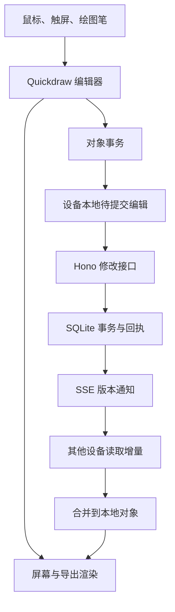

# 工程设计

## 编辑与持久化的边界

编辑器的坐标系、对象结构、单次手势历史和形状命中来自锁定版本的 Quickdraw。接口适配集中在 `client/canvas/sdk.ts`。桌面鼠标、触屏和绘图笔共享一个对象模型。普通对象、附件引用和场景有各自的校验规则，服务器负责检查权限、分配版本和提交事务。

### 从输入到一笔可撤销的墨迹

1. 按下时选取指针，逆映射相机得到画板坐标。移动时吸收浏览器合并的采样。输入结构分别保存压感、笔身相对于两个轴的倾角、笔杆旋转和切向压力。
2. 笔压改变接触半径。倾角的投影决定接触椭圆的长轴方向，倾斜幅度和笔刷类型决定长短轴比。相邻采样的接触轮廓连续连接。笔尖回直、鼠标缺失传感器、真实零压力分别处理。
3. 进行中的手势在本地预览。抬笔提交为一次用户动作。取消、丢失捕获或手掌接触不能把半条草稿上传为完整笔迹。较长笔画内部能分段，上层保留手势边界。
4. 重绘和 PNG/PDF 导出走同一形状绘制逻辑。可编辑文件保留几何和传感器样本，可以重新着色、移动或擦除。图片保留原始文件字节和独立裁剪参数。

### 同一块画板上的两次并发修改

| 情况 | 客户端和服务端的处理 |
| --- | --- |
| 两台设备改不同对象 | 服务端检查本次改动涉及的对象版本，接受可以安全合并的过期基准版本 |
| 两台设备改同一对象的不同属性 | 返回版本冲突后读取最新增量，对比原值、本地期望值和远端现值，合并互不冲突的字段 |
| 两端改同一形状的同一字段 | 远端版本继续保留，本地修改另存为带来源标记的形状副本 |
| 网络在提交成功后中断 | 保留原操作 ID 并重试，服务端通过事务内回执识别重复提交 |
| 同一设备多标签页离线后关闭 | 按工作区、画板与写入者分别记账，恢复时使用 Web Locks 认领待提交记录并按原操作重放 |
| 查看者被移出画板 | 服务器重新检查授权，前端关闭旧编辑器，清空画布与已撤销访问的本地缓存 |

服务器在同一 SQLite 事务里检查旧版本并写入对象、删除记录、版本号和操作回执。确认响应在提交之后返回。SSE 通知携带最新版本，错过通知的客户端用上次已确认版本读取增量。其他设备的光标和相机属于短时状态，可以丢失与重建，不参与文档版本分配。

### 画板、资源和身份

- 工作区承载画板目录、文件夹与收藏。一次性配对在第二台设备上授予同一工作区身份。给协作者的链接只授予指定画板及其附件权限。
- 附件二进制与元数据保存在服务端 SQLite。把含附件的对象复制到另一画板时，服务端同时核查来源读取权限与目标写入权限，再建立目标画板自己的资源。
- 离线快照和素材缓存按设备工作区隔离。已确认的授权错误会清理相关缓存。离线时，浏览器只能根据最后一次在线授权访问曾缓存的内容，重新联网时会核对现有授权。
- 容量上限、单主机部署边界、备份位置、恢复命令及回收策略见 [存储与同步](storage.md)。备份包含授权和原始附件，单板导出面向移植与继续编辑。

## 变更验证

协议、事务、幂等、回收站、笔尖几何和离线合并在 Bun 测试中验证。浏览器验收从产品工具栏发起输入，在另一浏览器、刷新后的页面、下载的文件或服务重启后的数据库观察结果。可重复执行的工作流、原始测量与功能边界分别见 [浏览器验收](../qa/README.md) 和 [能力矩阵](capabilities.md)。
